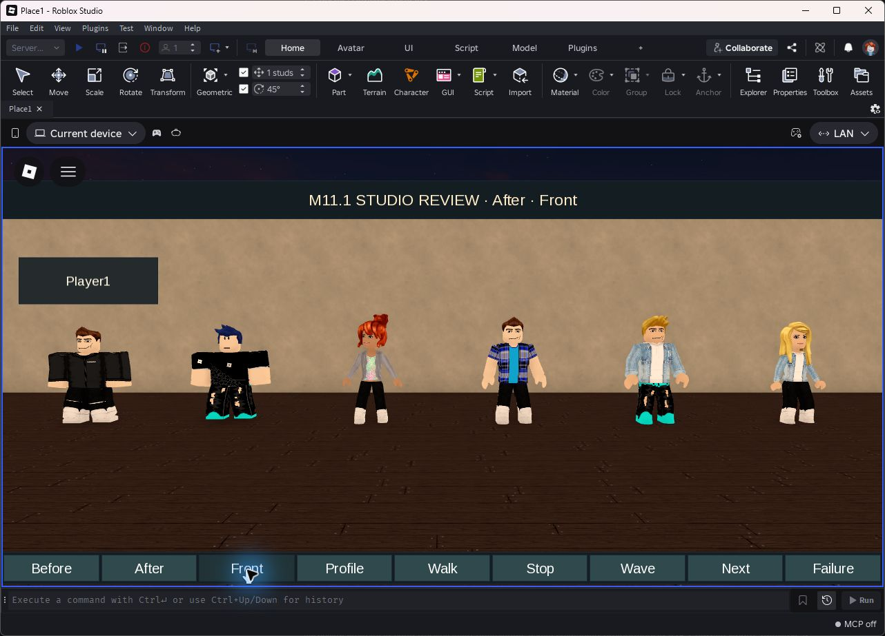

# M11.1 — проверка R15-мимиков

Issue #27. База: M11 `c672e96457d15d92aa1c6d1fa10db8de7ccd5bf4`.
Работа и сборки выполнены на G:/. PR направляется в `feat/m11-retention-observability`.
**Визуальное принятие пользователем ещё не выполнено; PR остаётся Draft.**

## Подлинные кадры Studio

PNG сняты непосредственно с окон Roblox Studio 0.745.462.7451125 на Windows,
без обработки изображения или генеративных замен. Оригиналы, SHA-256 и время
сохранения перечислены в [manifest.json](evidence/M11-1/manifest.json).

Сравнительный стенд использует одно освещение, FOV 38, одну камеру и одинаковые
позиции. Слева — настоящий клиентский Player1 с обычным бесплатным Roblox-образом
(описание применено только в fixture), справа — пять NPC. Старые модели создаются
**точной копией** `MimicRig` из M11, включая его прежний fallback. Хеш исходника:
`166bcfcf32bb2f5fbef75c43aa6597c72dad1339eb2b3f71111c3977fc13369f`.
Это воспроизведение старой реализации на текущем движке, а не исторический снимок.

| Проверка | До | После |
|---|---|---|
| Пять мимиков + настоящий Player, фронт | [Фронт M11](evidence/M11-1/before-front.png) | [Фронт M11.1](evidence/M11-1/after-front.png) |
| Те же персонажи, профиль | [Профиль M11](evidence/M11-1/before-profile.png) | [Профиль M11.1](evidence/M11-1/after-profile.png) |

- Анимации: [Idle](evidence/M11-1/after-front.png) → [Walk](evidence/M11-1/after-walk.png) → [Stop](evidence/M11-1/after-stop.png) → [Wave](evidence/M11-1/after-wave.png). Ходьба — настоящий Humanoid:MoveTo, жест — серверный AnimationTrack. Синхронный жест на стенде специально вызван одной кнопкой; игровое поведение использует разные паузы.
- Весь каталог: [1–5](evidence/M11-1/catalogue-01-05.png), [6–10](evidence/M11-1/catalogue-06-10.png), [11–15](evidence/M11-1/catalogue-11-15.png), [16–20](evidence/M11-1/catalogue-16-20.png). Порядок внутри кадра справа налево, Player1 всегда слева; группа 1–5 снята во время Wave, остальные — Idle.
- Контексты: [приватный пролог](evidence/M11-1/prologue.png), [лобби](evidence/M11-1/lobby.png), [первый этаж](evidence/M11-1/match-ground.png), [второй этаж](evidence/M11-1/match-upper.png).
- Отказ: [тот же полноценный R15 из кеша](evidence/M11-1/api-failure.png). Исключение возникает внутри реального production-пути создания шаблона, после чего выбирается уже проверенный кеш; блочная замена не допускается.
- Игровые проверки: [Council](evidence/M11-1/council.png), [успешный выход шпиона](evidence/M11-1/spy-extraction.png).

Для контекстных кадров fixture ждёт реальное прибытие NPC и временно задерживает
его следующее задание, пока оператор сохраняет кадр. Положение тела не меняется.
Камера проверяет препятствия; остальные NPC продолжают жить. В сравнительном
стенде размещение ряда фиксировано специально для одинакового масштаба.

## Автоматические проверки

**3869 assertions PASS:** все **3187 M11 сохранены без изменений** плюс 568
проверок каталога/очереди загрузки, 53 реального контроллера Animator, 41 реального
допуска R15 и 20 клиентского ожидания контента. Тестовые обёртки исполняют текущие
production-модули, а не копии их реализации.

Проверяются пропавшие части/суставы/одежда, R6, неверные ID и тип аксессуара,
layered hair, Motor6D/AnimationConstraint, скорость/гистерезис/жесты, Council,
очистка треков, ограничение параллельных preload, незавершённые/поздние ответы,
повторные ошибки, fade и сохранение поведения обычных NPC.

Luau compile/analyze, поиск неизвестных runtime globals, production и десять
fixture-сборок Rojo, аудит production/remotes/изоляции fixtures/чата/ассетов — PASS.
[Полный локальный протокол](evidence/M111-automated.log). GitHub Actions повторяет
эти проверки; ссылка на запуск финального SHA приводится в PR.

## Studio: результаты

Новый прогон выполнен для M11.1; исторические PASS M9–M11 не используются как
замена. Профили работают через FakeMemory, реальные покупки выключены.

- 20/20 пресетов: полноценный R15, применённая одежда и аксессуар, шесть готовых треков, отсутствие оставшихся треков после уничтожения.
- 43 используемых asset ID: автор Roblox, правильные типы, бесплатная одежда/волосы; проверены серверная сборка и клиентское отображение. [Метаданные](evidence/M111-assets.json).
- Холодный отказ не выпускает замену. Четыре конкурирующих запроса при искусственной задержке 10 секунд дают один реальный запрос; допуск завершается через 8 секунд, поздний ответ заполняет кеш без осиротевшей модели.
- Настоящие процессы Studio: 1 → 2 → 3 клиента. Один человек остаётся в ожидании; два получают Owner/Spy, шесть мимиков — Guest. Мимики не имеют профилей и не считаются людьми.
- Физическая доставка на втором этаже приватного пролога, очистка сцены, принятие приглашения и переход в матч. Это учебная доставка; новый отдельный Staff-плейтест не подменяется этим результатом, прежние Staff-регрессии сохранены.
- Реальные маршруты мимиков на обоих этажах, Guest-заказы, Council с остановкой тела/треков/часов, физический вынос досье игроком Spy и reset.
- Третий посетитель остаётся вне текущего раунда, получает приватную сцену; плотность Lobby уменьшается. Три быстрых выхода/возврата оставляют ровно одного проводника, внешность существующих Actor не меняется.
- Отдельный уход настоящего тестового клиента с активным NPC проверяет уничтожение private scene, модели и освобождение очереди/треков.

Из журналов сохраняются только относящиеся к проверке строки, без сырых сетевых
логов: [каталог](evidence/M111-review-studio.log), [интеграция](evidence/M111-integration-studio.log).

## Измерения и ограничения

Финальная интеграция: 2026-11-03, 13:14–13:21 UTC, Studio 0.745.462.7451125.
Запросов создания — 18, одновременно максимум 1; ошибок Avatar API — 0,
тайм-аутов — 0, попаданий в кеш — 17. Максимальное время успешного `Rig.new`
— 1,249 с. Обобщённый счётчик `MimicService.failures` — 1, `Rig.deferred` — 1;
первый включает неуспешный допуск и ошибки задач движения, поэтому не
выдаётся за счётчик ошибок Avatar API. Незавершённых актёров тест не обнаружил.

Маршруты: 126 заданий, 119 прибытий/действий, 33 действия в матче,
10 прибытий на второй этаж, 6 Guest-заказов; максимум 2 path worker.
После reset и ухода третьего клиента осталось 3 действующих Lobby-мимика
с 18 треками и 0 незавершённых загрузок; освобождённые модели/треки проверены.

Клиентские выборки по 600 кадров: Player1 — 18,89 FPS, Player2 — 49,25 FPS.
Окна переключались, фоновые процессы Studio ограничивают частоту кадров;
это **не** сравнение производительности «до/после» и не mobile-бенчмарк.
Подробные числа: [M111-measurements.json](evidence/M111-measurements.json).

Каталог проверен 2026-11-03, 13:24–13:33 UTC. Создание отдельного пресета
после искусственного отказа: 0,234–0,923 с; время не включает клиентский fade.
Отдельная проверка задержки 10 с дала ровно один 8-секундный тайм-аут допуска
и один незавершённый запрос при четырёх вызывающих потоках.

Искусственная задержка/исключение проверяют управление ошибками, но не заменяют
испытание на физическом устройстве с потерями пакетов. Физический mobile,
живой человеческий матч, повторное подключение того же аккаунта через публичный
Roblox и межсерверный TeleportService здесь не проверялись. Повторные входы в
пролог проверены с тем же локальным Player, отключение — настоящим выходом клиента.

В Studio встречаются предупреждения встроенных UI StyleRule, трактовки font JSON
как текстуры, Wrap-deformer и фоновых плагинов. Они не считаются PASS игрового кода.
Недоступная вложенная текстура причёски 62234425 была найдена именно клиентской
проверкой; ассет исключён из production-каталога. Детали — в документе ассетов.

Каталог намеренно ограничен бесплатными стандартными ресурсами: smart-casual
представлен рубашками/куртками, без отдельной коллекции платьев. Геометрия лобби,
маршруты, баланс, DataStore, Robux и межсерверные release gates не переделывались.

## Повторение

1. Собрать `mimic-avatar-review.project.json` через Rojo; открыть локально в Studio, Server & Clients = 1. Дождаться `M111 CATALOGUE READY` (проверка метаданных и всех 20 пресетов).
2. Кнопки Before/After и Front/Profile дают одинаковую постановку; Walk → Stop → Front → Wave проверяют движение/жест. Перед повторным Wave нажать Stop. Next перебирает четыре группы по пять. Failure вызывает отказ и проверяет кеш. Снимать кадр после завершения плавного появления.
3. Собрать `mimic-avatar-tests.project.json`; начать с одного клиента. На каждом экране Capture сохранить изображение и нажать Continue. После `M111 SOLO PASS` добавить одного клиента, после `M111 TWO PASS` — ещё одного. Роли закреплены только в fixture.
4. Дождаться `M111 STUDIO SUITE PASS`. Последний клиент намеренно отключается тестом после матча; это проверка очистки, а не сбой игры. Проверить журнал на `M111 STUDIO FAIL`.
5. Все повторяемые локальные и CI-команды перечислены в `.github/workflows/check.yml`. Studio запускается отдельно: CI не выдаётся за реальный запуск движка.
