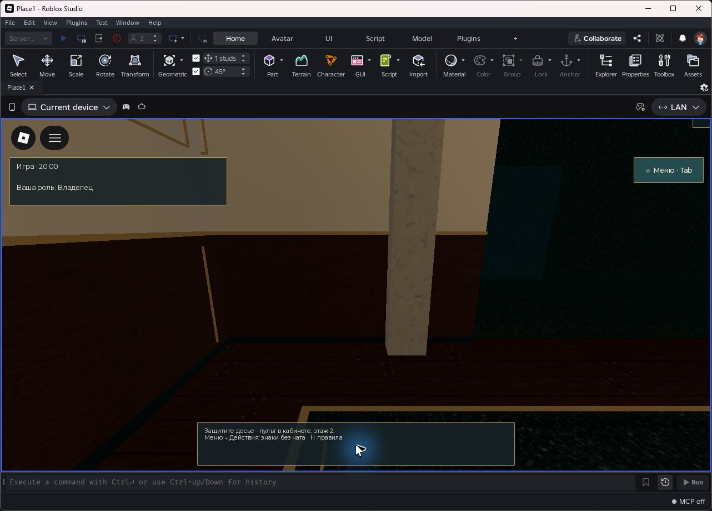
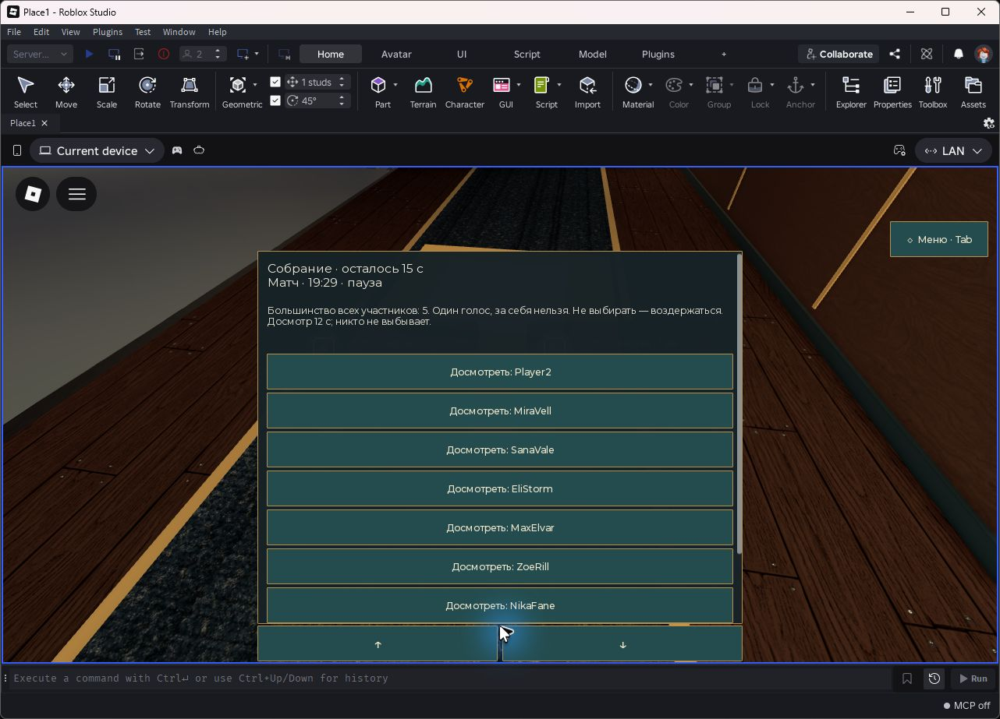
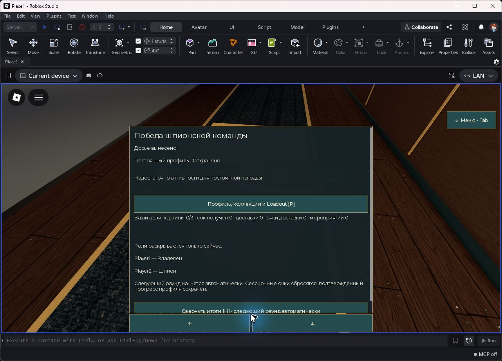

# M12.0 — лимит активного времени матча

Задача [#31](https://github.com/branch-danya-dev/Double-Life/issues/31). Ветка `feat/m12-0-ranked-match-20m` создана после завершения #32 и успешного Actions [41719789281](https://github.com/branch-danya-dev/Double-Life/actions/runs/41719789281). Точная stacked база: `fix/m11-2-1-visual-gate`, **`2e72a95ab046264893460a8f0f22231b24b3749a`**, Draft PR [#33](https://github.com/branch-danya-dev/Double-Life/pull/33). Никаких merge или переписывания предыдущих веток.

Проверяемая реализация: **`138ef07430c69040c5294150fb7dbbcf4723e044`**. Финальная доставка добавляет только отчёт и свидетельства; точный финальный HEAD и Actions связываются в описании Draft PR и выдаваемой копии отчёта. Манифест свидетельств содержит SHA-256 исходников и реально открытой сборки Studio.

## Поведение и границы изменения

- `Config.ROUND_SECONDS = 1200` — единый серверный лимит всего Active. Countdown 12 с, Council 25 с и Results 12 с в него не входят.
- После 420 с остаётся 780 с; после 1199 — одна секунда. На 1200 наступает `Defenders/Timeout`. Большой шаг времени ограничивает `elapsed` реально оставшимся бюджетом, чтобы телеметрия не записывала лишнее активное время.
- Council сохраняет остаток, приостанавливает активный/world clock и возвращает его без сброса. Прежняя обработка большого `dt`, пересекающего конец Council, сохранена: избыток этого шага не списывается из Active. `SessionClock` не менялся.
- `Spy/Extraction` и уход последнего шпиона завершают матч немедленно. Первый из двух шпионов может уйти без окончания матча. Повторный report/extract/leave не создаёт второй `RoundFinished` или награду.
- `RoundTime` форматирует серверные снимки; основной HUD использует `activeRemaining` в Council. Видимое окно голосования отдельно показывает обратный отсчёт собрания и остаток матча с подписью «пауза».
- Награды, досье 60 с, одно собрание после 30 с, досмотр 12 с, события, заказы, анти-AFK, роли, NPC, экономика, DataStore и подбор не менялись. `assets/M7-manifest.json` обновляет только хеш изменённого HUD.

## Автоматическая проверка

**4464 assertions PASS: 4240 прежних + 224 новых** (158 в общей CLI/Studio timeline, 66 через настоящий `RoundService` с адаптацией движка). Полный журнал: [M120-automated.log](evidence/M120-automated.log).

Новые проверки: точный старт и границы 420/1199/1200, огромный `dt`, ранний вынос на 90/1100/1199.999, обе последовательности extraction↔timeout, Council на границах и при уходе игроков, два шпиона, Results/reset, повторный матч, HUD `20:00`, `10:00`, `09:59`, `00:01`, `00:00`, неотрицательное округление, два таймера модального окна. Проверка сервиса вызывает production tick/report/snapshot/extract/leave; счётчик событий и реальная `ProgressionPolicy.reward` подтверждают single settlement. Персонал при квалифицированном проигрыше сохраняет **50 XP / 19 жетонов**.

Все 4091 утверждение M11.2 и 149 M11.2.1 сохранены. Единственные изменения прежних исполняемых проверок:

| Файл | Причина |
| --- | --- |
| `rounds.luau`, `social.luau`, `matchmaking.luau` | Полный timeout теперь вызывается с `Config.ROUND_SECONDS`, прежние утверждения о защитниках и отсутствии повторного исхода сохранены |
| `retention.luau`, `telemetry-runtime.luau` | Полные синтетические матчи используют 1200; сдвинуты следующие моменты времени, сохранены раздельные wall/active интервалы, дедупликация и expiry |
| `check-build.py` | Проверяет production-константу 1200 |
| `m4/Runner.server.luau` | Ожидание настоящего полного тайм-аута следует Config + 10 с; не ускоряет матч |
| `m2`, `m6`, `m8` runners | Обновлены только комментарии о длительности |

Независимые примеры 420 с в `progression.luau`/`balance.luau` оставлены: это примеры активности/AFK, а не ожидание конца раунда. Порог высоты экрана 420 в Atmosphere не связан со временем. Текущие README, инструкции M2/M3/M4/M6/M8/M9 и спецификация телеметрии обновлены. Исторические отчёты M2/M4/M6/M7/M8/M11.2.1 сохраняют реальные старые 420-секундные запуски и явно помечены историческими.

Luau 0.745 compile всех исходников/тестов, analyze pure-модулей и новых тестов, аудит неопределённых runtime globals, Rojo 7.7.1 production + **14 fixtures**, изоляция MemoryStore/Main, security/build/chat и оба asset-аудита проходят. Новая сборка входит в GitHub Actions artifact `DoubleLife-M12-0`.

## Воспроизведение Studio

Собрать `rojo build match-duration-tests.project.json -o DoubleLife-M120-tests.rbxlx`, открыть локально и запустить **Server & Clients / 2**. В первом клиенте нажать «M12.0 · Начать проверку». После первого Results/reset снова нажать кнопку. Требовать завершающий `M120 STUDIO SUITE PASS`, а не отдельные промежуточные PASS.

Стенд использует настоящие Players, Humanoid/Pathfinding и ProximityPrompt. Роли закреплены только для воспроизводимости. Внутри маршрутов тела не телепортируются; серверные результаты и HUD не подменяются. Хранилище — изолированный адаптер в памяти. Countdown, Council и короткие Active идут на обычном Heartbeat.

Итоговый запуск 2026-11-04 по Москве (2026-11-03 **21:34:55–21:39:37 UTC**) завершился **M120 STUDIO SUITE PASS**. Сборка `DoubleLife-M120-final.rbxlx` сверена с реализацией: все **78 production scripts/modules** совпадают. [Манифест и SHA-256](evidence/M120-evidence.json), [санитизированный журнал](evidence/M120-studio-final.log). Сохранены только собственные сообщения теста, без сетевых и учётных данных из сырых логов Studio.

| Сценарий | Реальный результат |
| --- | --- |
| Первый старт | Оба клиента зафиксировали `Игра · 20:00`; Owner/Spy — настоящие Players; шесть R15 Guest, восемь участников |
| Council через настоящий пульт | Остаток **1168.666429 с**; Active/world clock замерли; отдельный Council продолжался 25 с; восстановление того же остатка без сброса |
| Видимое окно голосования | Кадр показывает `Матч · 19:29 · пауза` и независимые `15 с` собрания; клиентская проверка текста прошла |
| Первый вынос | Физический маршрут и prompts; немедленный `Spy/Extraction` после **72.515466 с Active**, ровно один `RoundFinished` |
| Results → Waiting | Match-акторы и policy roster очищены; повторный вход через обычный Countdown |
| Второй матч | Снова два настоящих клиента + шесть Guest и `20:00` в обоих HUD; физический вынос через **51.930345 с Active** |
| Повторный reset | Match-акторы очищены; за два матча ровно два события завершения; финальный suite PASS |
| Длинная временная шкала | **158 assertions PASS** в Studio на production policy с виртуальным `dt`; отдельно от физического сценария |

Начало матча, настоящий клиентский HUD:

Пауза матча и отдельный таймер собрания:

Досрочная победа после первого физического выноса:

Дополнительные неизменённые кадры в манифесте показывают ход отсчёта, возврат после Council, начало второго матча и Waiting после второго reset. Экран Results второго матча не захвачен; его исход подтверждён серверным журналом и финальными assertions. Скриншоты не заменяют проверки состояния.

До итогового запуска первый прототип стенда остановлен из-за исчезавшей при spawn кнопки старта; второй подтвердил один физический матч, после чего был остановлен для исправления видимого Council HUD. Эти промежуточные запуски не включены в доказательство итоговой реализации.

В кадре Council заметна прежняя подпись большинства по размеру общего roster (`5` для двух людей и шести мимиков), хотя сервер считает реальных участников. Это существующее расхождение подписи, вне точечной настройки длительности; логика голосования здесь не изменена.

## Состав поставки

Production: `Config.luau`, `RoundPolicy.luau`, новый `RoundTime.luau`, `Hud.client.luau` и хеш HUD в M7 manifest. Серверный `RoundService` использован без изменений. Новые тесты: `tests/m120/*`, `match-duration.luau`, `match-duration-runtime.luau`, `run-match-duration.py`, `match-duration-tests.project.json`; CI включает их и публикует новую сборку. Изменения прежних тестов перечислены выше. README и текущие руководства синхронизированы; исторические доказательства сохранены. Этот отчёт, два журнала, манифест и восемь оригинальных кадров составляют проверяемые свидетельства.

## Непроверенное и дальнейший дизайн

**Полный физический 20-минутный прогон Studio не выполнялся.** Длинный timeout проверен воспроизводимой production state machine с виртуальным `dt` в CLI и Studio; это не доказательство 20 минут физической симуляции, нагрузки или интереса игрока. Локальные клиенты с автоматическим драйвером не являются живым плейтестом.

**1200 секунд — утверждённый проектный лимит, не эмпирически подтверждённая оптимальная длина.** Досье 60 с, одно Council, досмотр, улики, лимиты поручений/событий, награды, анти-AFK и охрана создавались под семь минут. Их влияние на утомление, пассивное ожидание, темп расследования, ранние победы и экономику требует отдельного M12 game-design/balance pass. Здесь эти параметры намеренно сохранены.

Production DataStore, опубликованные сервисы, межсерверный Teleport и Robux не использовались; существующие published-gates остаются обязательными. Приёмка широких визуальных кадров мимиков относится к предыдущему Draft PR #33.
